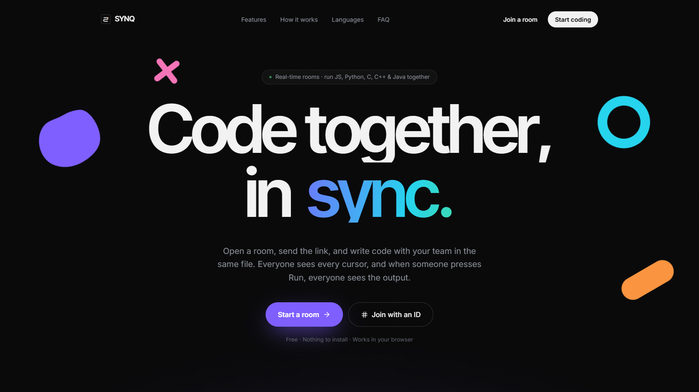
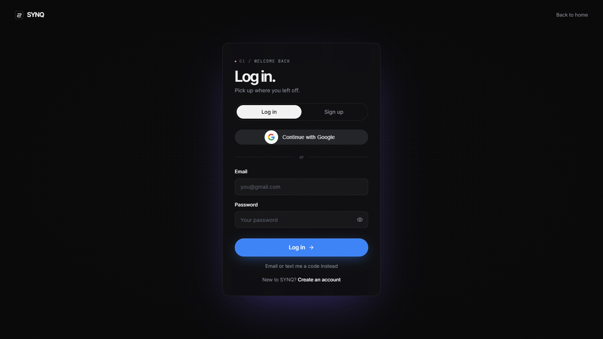
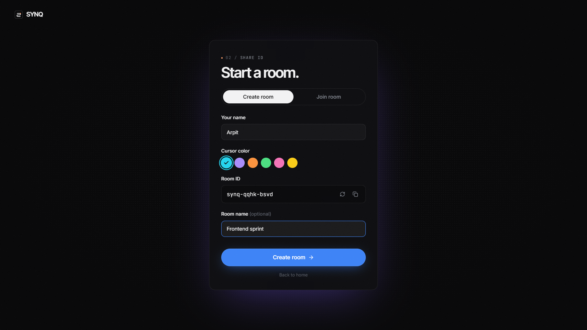
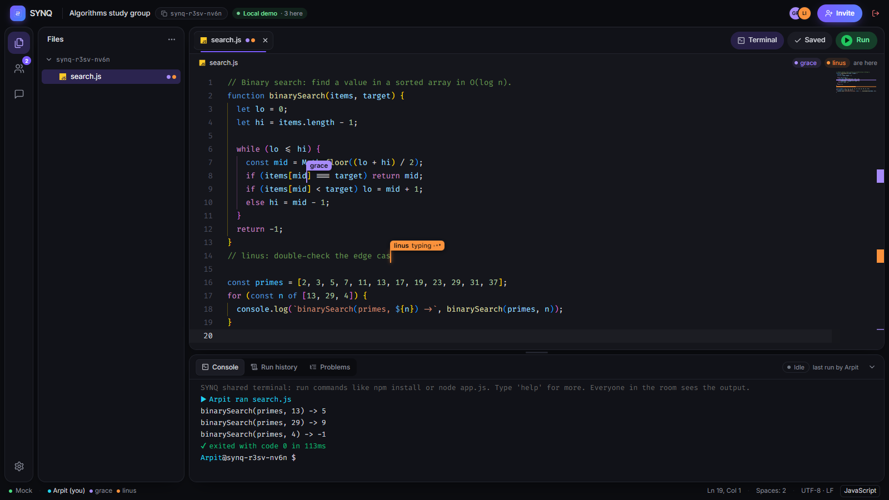
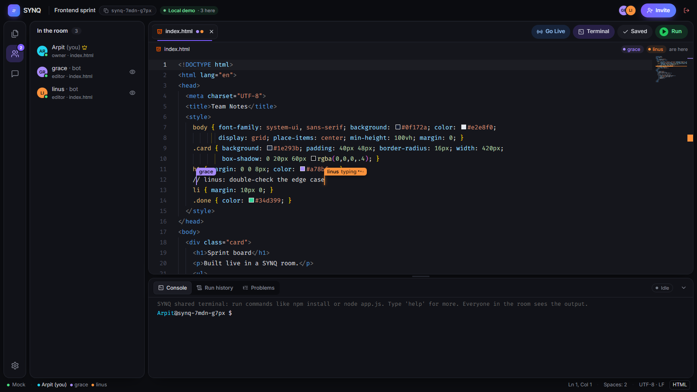
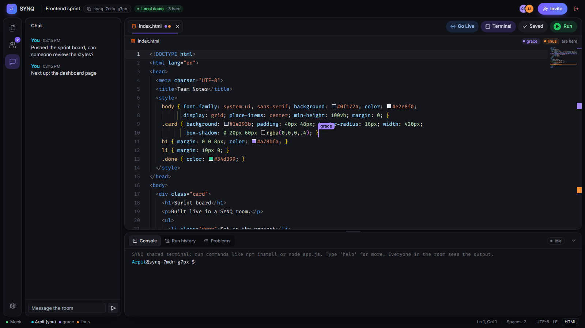

# SYNQ (Real-time Collaborative Code Editor)

SYNQ is a code editor that runs in the browser and lets a whole team work in the same files at
the same time. Create a room, share the link, and everyone codes together with live cursors,
chat, a shared terminal and one-click push to GitHub. I built it to make pair programming,
study groups and coding interviews feel like sitting at the same desk, with no screen sharing
and no sending files back and forth.

## Tech Stack

**Client:** React, Vite, Tailwind CSS, Monaco Editor, xterm.js, Zustand

**Server:** Node.js, Socket.IO, Yjs, MongoDB, JWT, Nodemailer

## Features

- Real-time editing with live cursors for everyone in the room
- VS Code–like editor with IntelliSense and snippets
- Run JavaScript, TypeScript, Python, C, C++ and Java with shared output
- Shared terminal (`npm install`, `node app.js` and more)
- Go Live preview for HTML pages that updates as you type
- Room chat and a list of who is online
- Invite links, with the owner accepting or declining people
- Editor and viewer roles, and owner-only controls
- Push the room's code to GitHub in one click
- Log in with password, email/SMS code or Google
- Login history (every signup, login and logout is recorded)
- Rooms are saved in MongoDB and can be downloaded as a `.zip`

## Demo

There's no hosted version yet. Follow [Run Locally](#run-locally) below.

To just look around without setting up a database, start the client in demo mode with
`VITE_USE_MOCK=true`. It opens a sample room with two simulated teammates.


## Screenshots

**Home Page**


**Login Page** (Google, password or a one-time code)


**Start a Room** (pick your name, cursor color and room ID)


**Editor** (live cursors of teammates and the shared run output)


**People in the Room** (who is online, their role and the file they're in)


**Room Chat**


<sub>The room screenshots were taken in demo mode, so the teammates are simulated.</sub>

## Run Locally

Clone the project

```bash
  git clone https://github.com/tmkarpit/synq
```

Go to the project directory

```bash
  cd synq
```

Install dependencies (client and server)

```bash
  npm run install:all
```

Copy `server/.env.example` to `server/.env` and set the environment variables
(at least `MONGODB_URI` and `JWT_SECRET`)

```bash
  cp server/.env.example server/.env
```

Start the server

```bash
  npm run dev:server
```

In a second terminal, start the client

```bash
  npm --prefix client run dev:lan
```

Open http://localhost:5173 in your browser

## Deploy

SYNQ runs as one Node.js service: the server also serves the website, so the site, API,
WebSockets and Go Live share one address. Use a host that keeps WebSockets open (Render,
Railway, Fly.io, a VPS) and a MongoDB database (MongoDB Atlas works).

With Docker

```bash
  docker build --build-arg SITE_URL=https://your-domain.com -t synq .
  docker run -p 4000:4000 --env-file server/.env -e NODE_ENV=production synq
```

Without Docker (Node.js 22.15 or newer): set `NODE_ENV=production` in `server/.env`, then

```bash
  npm run install:all
  SITE_URL=https://your-domain.com npm start
```

For production, set in `server/.env`: `MONGODB_URI`, `JWT_SECRET`, `COOKIE_SECURE=true`
(HTTPS), `TRUST_PROXY=1` when behind a load balancer, and the email settings
(`SMTP_*`) so people can sign up. `SITE_URL` (at build time) adds the canonical link,
link-preview image and `sitemap.xml`.

In production the terminal and Python/C/C++/Java are off by default, because they run
on the server without a sandbox; JavaScript and TypeScript run sandboxed (no files,
processes or network). Turn the others on with `SHELL_ENABLED=true` and `RUN_LANGUAGES`
only inside a container and for people you trust. See `server/.env.example` for every
setting.

## Contributing

Contributions are always welcome!

## Authors

- [@tmkarpit](https://www.github.com/tmkarpit) (Arpit Tamrakar)

## License

[MIT](https://choosealicense.com/licenses/mit/)
